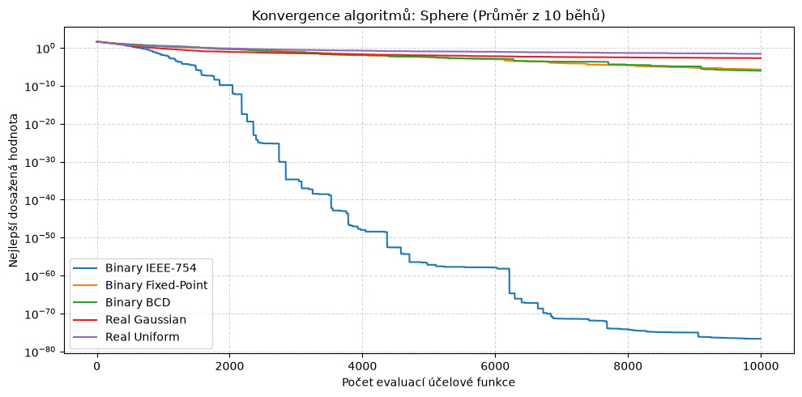
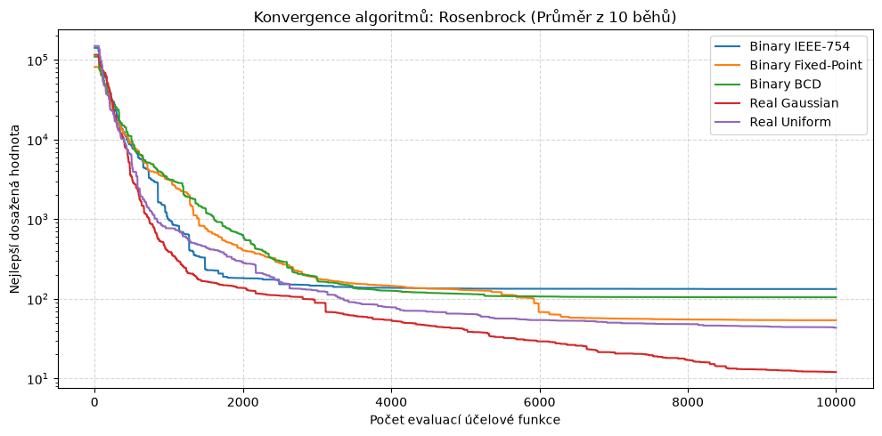
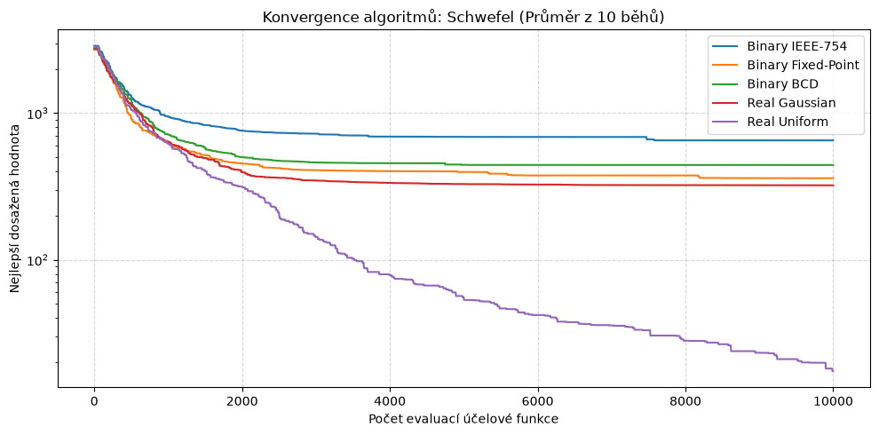

# **Úloha 2: Genetický algoritmus - reálné parametry**
> Kompletní jupyter notebook včetně kódu naleznete [zde](./real_valued_ga.ipynb).

## **Úvod a cíl úlohy**

Zatímco v první úloze byly optimalizovány jednoduché binární řetězce, cílem tohoto úkolu je vyzkoušet genetický algoritmus pro řešení úloh s **reálnými parametry** (tzv. spojitá optimalizace). 

Zásadním rozhodnutím při návrhu GA pro spojité prostory je volba reprezentace jedince (kódování) a na to navázaných genetických operátorů. V tomto experimentu jsou porovnány dva přístupy. Binárně kódovaný přístup (kdy se reálná čísla převádějí na bity) a přístup, který pracuje přímo s reálnými čísly.

Všechny úlohy jsou řešeny pro dimenzi 10D s pevným rozpočtem 10 000 evaluací účelové funkce. Cílem je vždy **minimalizace** dané funkce. Výsledky jsou zprůměrovány z 10 nezávislých běhů.

## **Varianty reprezentace a mutace**

Algoritmy byly testovány v 5 různých variantách rozdělených do dvou hlavních větví:

### 1. Překódování do binární reprezentace (32 bitů na dimenzi)
Hodnoty s plovoucí řádovou čárkou jsou transformovány na řetězce nul a jedniček. Křížení (single-point) a mutace (bit-flip) probíhá na úrovni jednotlivých bitů.
* **IEEE 754 (Single precision):** Standardní počítačová reprezentace floatu (1 bit znaménko, 8 bitů exponent, 23 bitů mantisa).
* **Fixed-Point:** 32 bitů je pevně rozděleno (1 bit znaménko, 11 bitů celá část, 20 bitů desetinná část).
* **BCD (Binary Coded Decimal):** Každá dekadická číslice je kódována 4 bity (celkem 8 číslic).

### 2. Real-valued GA (Kódování reálnými čísly)
Genom je přímo tvořen vektorem reálných čísel. Křížení (single-point) probíhá výměnou celých dimenzí mezi rodiči.
* **Gaussian mutace:** K existující hodnotě genu je přičten šum z normálního rozložení $N(0, \sigma^2)$. Provádí jemné lokální prohledávání.
* **Uniformní mutace:** Hodnota genu je absolutně nahrazena novým náhodným číslem z povoleného rozsahu. Slouží k agresivnímu globálnímu prohledávání.

## **Účelové funkce využité pro porovnání přístupů**

* **Sphere funkce:**
  * Nejednodušší testovací funkce. Je hladká, spojitá, konvexní a unimodální.
  * Globální minimum leží v bodě $(0, \dots, 0)$.
* **Rosenbrockova funkce:**
  * Globální minimum leží v úzkém, rovinatém, parabolickém údolí. Nalezení údolí je snadné, ale postupovat jím k optimu je obtížné.
  * Globální minimum leží v bodě $(1, \dots, 1)$.
* **Schwefelova funkce:**
  * Vysoce multimodální funkce s mnoha hlubokými lokálními minimy, která jsou od sebe daleko. Globální minimum leží na samém okraji prohledávaného prostoru, což snadno vede k uváznutí v lokálním optimu.
  * Globální minimum leží v bodě $(420.9687, \dots, 420.9687)$.

## **Výsledky experimentů**

## **Konvergenční grafy**

## **Závěr a shrnutí úkolu**

Výsledky experimentů jasně ukazují, že volba kódování a mutace by měla záviset na řešeném problému.

**Binární kódování (IEEE-754, Fixed-Point, BCD):** je pro spojitou optimalizaci je většinou **nevhodné**. Je náchylné na Hammingovy útesy a mutace neodpovídá metrice reálného prostoru (změna bitu může znamenat posun o $0.001$ i o $1000$).

**Real-valued kódování:** je pro spojitou optimalizaci mnohem přirozenější a efektivnější.

**Gaussova mutace** je ideální pro lokální dolaďování (exploitation) v hladkých prostorech (Rosenbrock).

**Uniformní mutace** je klíčová pro únik z lokálních minim a globální prohledávání (exploration) u multimodálních funkcí (Schwefel).