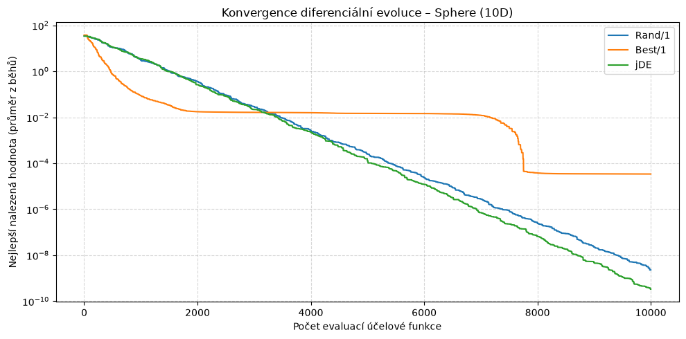
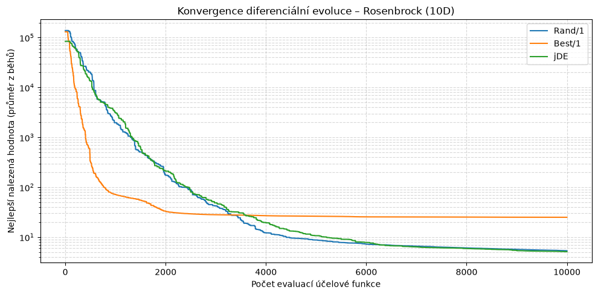
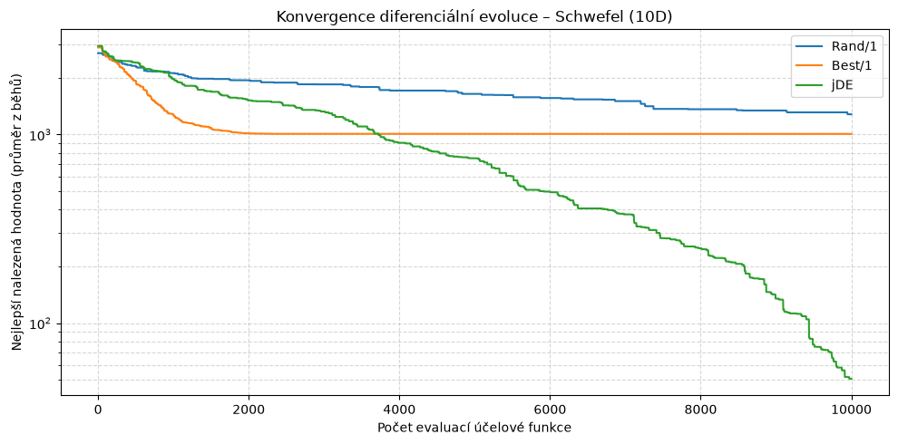

# **Úloha 3: Diferenciální evoluce**
> Kompletní jupyter notebook včetně kódu naleznete [zde](./differential_evolution.ipynb).

## **Úvod a cíl úlohy**

Cílem úkolu je implementovat **diferenciální evoluci (DE)** a porovnat konvergenci tří jejích verzí na standardních testovacích funkcích. Na rozdíl od genetického algoritmu z předchozích úloh DE nepoužívá selekci rodičů, ale vytváří nové jedince **mutací pomocí rozdílu vektorů** již existujících jedinců populace.

Jeden krok DE pro každého jedince $\mathbf{x}_i$ probíhá takto:
1. **Mutace:** vytvoření mutačního vektoru $\mathbf{v}_i$ z ostatních jedinců populace.
2. **Binomické křížení:** zkušební vektor $\mathbf{u}_i$ přebírá každou složku z $\mathbf{v}_i$ s pravděpodobností $CR$, jinak z $\mathbf{x}_i$ (alespoň jedna složka je vždy z $\mathbf{v}_i$).
3. **Selekce:** $\mathbf{u}_i$ nahradí $\mathbf{x}_i$, pokud není horší ($`f(\mathbf{u}_i) \le f(\mathbf{x}_i)`$).

Všechny úlohy jsou řešeny pro dimenzi 10D s pevným rozpočtem 10 000 evaluací účelové funkce a populací o velikosti 50 jedinců. Cílem je vždy **minimalizace** dané funkce. Výsledky jsou zprůměrovány z 10 nezávislých běhů.

## **Varianty diferenciální evoluce**

| Varianta | Mutace | $F$ | $CR$ |
| :--- | :--- | :--- | :--- |
| **Rand/1** | $`\mathbf{v}_i = \mathbf{x}_{r1} + F (\mathbf{x}_{r2} - \mathbf{x}_{r3})`$ | 0.5 | 0.8 |
| **Best/1** | $`\mathbf{v}_i = \mathbf{x}_{best} + F (\mathbf{x}_{r1} - \mathbf{x}_{r2})`$ | 0.5 | 0.8 |
| **jDE** | Rand/1 s adaptivními parametry | počáteční 0.5 (rozsah 0.1 až 0.9) | počáteční 0.9 (rozsah 0 až 1) |

Indexy $r1, r2, r3$ jsou vzájemně různé a různé od $i$. Hodnoty mimo definiční obor funkce se po mutaci ořezávají na jeho hranice.

* **Rand/1:** základem je náhodný jedinec, silně podporuje průzkum prostoru (exploration).
* **Best/1:** základem je nejlepší jedinec populace, konvergence je rychlejší (exploitation), ale hrozí předčasná konvergence.
* **jDE:** každý jedinec nese vlastní $F_i$ a $CR_i$. Před vytvořením zkušebního vektoru se s pravděpodobností $\tau_1 = \tau_2 = 0.1$ přegenerují ($F_i = 0.1 + 0.8 \cdot rand$, resp. $CR_i = rand$). Nové hodnoty se zachovají jen tehdy, pokud zkušební vektor uspěl v selekci.

## **Účelové funkce využité pro porovnání přístupů**

* **Sphere funkce:**
  * Nejjednodušší testovací funkce. Je hladká, spojitá, konvexní a unimodální.
  * Globální minimum leží v bodě $(0, \dots, 0)$, rozsah $[-5.12, 5.12]$.
* **Rosenbrockova funkce:**
  * Globální minimum leží v úzkém, rovinatém, parabolickém údolí. Nalezení údolí je snadné, ale postupovat jím k optimu je obtížné.
  * Globální minimum leží v bodě $(1, \dots, 1)$, rozsah $[-5, 10]$.
* **Schwefelova funkce:**
  * Vysoce multimodální funkce s mnoha hlubokými lokálními minimy, která jsou od sebe daleko. Globální minimum leží blízko okraje prohledávaného prostoru.
  * Globální minimum leží v bodě $(420.9687, \dots, 420.9687)$, rozsah $[-500, 500]$.

## **Výsledky experimentů**

### **Sphere**

| Varianta algoritmu | Nejlepší | Nejhorší | Průměr | Medián | Směrod. odchylka |
| :--- | :--- | :--- | :--- | :--- | :--- |
| **Rand/1** | 6.40e-10 | 6.72e-09 | 2.28e-09 | 1.34e-09 | 2.09e-09 |
| **Best/1** | 1.08e-10 | 9.38e-05 | 3.40e-05 | 2.35e-05 | 3.54e-05 |
| **jDE** | **6.03e-11** | **7.85e-10** | **3.29e-10** | **2.15e-10** | **2.32e-10** |

### **Rosenbrock**

| Varianta algoritmu | Nejlepší | Nejhorší | Průměr | Medián | Směrod. odchylka |
| :--- | :--- | :--- | :--- | :--- | :--- |
| **Rand/1** | 4.26 | **6.43** | 5.34 | 5.49 | **0.574** |
| **Best/1** | 3.03 | 72.5 | 25.0 | 12.7 | 24.7 |
| **jDE** | **1.44** | 6.93 | **5.11** | **5.26** | 1.50 |

### **Schwefel**

| Varianta algoritmu | Nejlepší | Nejhorší | Průměr | Medián | Směrod. odchylka |
| :--- | :--- | :--- | :--- | :--- | :--- |
| **Rand/1** | 1000 | 1680 | 1281 | 1288 | 184 |
| **Best/1** | 595 | 1426 | 1007 | 1019 | 321 |
| **jDE** | **0.175** | **127** | **50.6** | **44.9** | **47.2** |

## **Konvergenční grafy**

## **Závěr a shrnutí úkolu**

Experimenty potvrdily, že volba mutační strategie zásadně ovlivňuje rovnováhu mezi **průzkumem** (exploration) a **dolaďováním** (exploitation).

**Best/1** je nejrychlejší na začátku běhu, ale na všech funkcích brzy **stagnuje**. Na Sphere uvízl kolem $10^{-2}$ a výsledek $3.4 \cdot 10^{-5}$ je o několik řádů horší než u ostatních variant. Na Rosenbrocku skončil s průměrem $25.0$ a největším rozptylem, na Schwefelovi zůstal kolem hodnoty $1000$. Populace ztrácí diverzitu a nemá z čeho vytvářet nové smysluplné rozdíly vektorů.

**Rand/1** konverguje pomaleji, ale **stabilně**. Na Sphere dosáhl $2.3 \cdot 10^{-9}$ a na Rosenbrocku po cca 3 500 evaluacích předstihl Best/1 (průměr $5.34$ s nejmenším rozptylem z celé trojice). Na multimodálním Schwefelovi mu s pevným $F = 0.5$ a $CR = 0.8$ nestačil rozpočet (průměr $1281$, nejhorší ze všech variant).

**jDE** byl na všech funkcích nejlepší nebo srovnatelný s nejlepším. Na Sphere dosáhl přibližně 7× lepšího průměru než Rand/1 ($3.3 \cdot 10^{-10}$). Na Rosenbrocku jsou Rand/1 a jDE prakticky stejné (průměr $5.11$ oproti $5.34$) a žádná varianta nenašla globální minimum. Zásadní rozdíl je u **Schwefela**: jDE po cca 3 800 evaluacích předstihl Best/1, dále trvale klesal a dosáhl průměru $50.6$ (nejlepší běh $0.175$, tedy téměř globální minimum). Ani po 10 000 evaluacích ještě nezkonvergoval. Adaptace $F$ a $CR$ umožňuje každému jedinci najít vhodnou velikost kroku a míru křížení pro aktuální fázi hledání bez ručního ladění.

**Shrnutí:**
* **Best/1** je vhodný pouze pro jednoduché unimodální úlohy a malý rozpočet, kde záleží na rychlém počátečním pokroku.
* **Rand/1** je robustní, ale výsledek závisí na ručně zvolených $F$ a $CR$.
* **jDE** dosahuje díky samoadaptaci parametrů nejlepších výsledků bez ladění a nejlépe zvládá multimodální krajinu.

*Jelikož však vycházím pouze z 10 běhů a jedné velikosti populace, jedná se jen o orientační srovnání, nikoli o statisticky ověřený test.*
